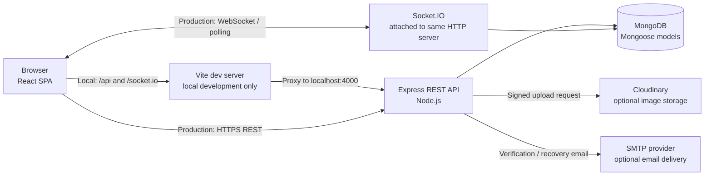
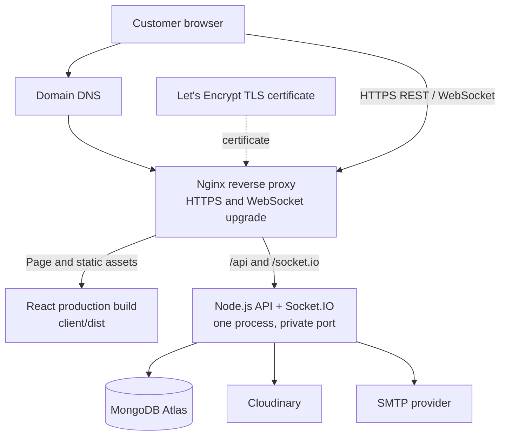

# WolfLink — Project Architecture & Interview Guide

> Use this document to explain the architecture that exists in the repository and a simple production deployment option. The production hosting section is a proposal: WolfLink has not been deployed and no production host has been selected yet. Do not describe proposed infrastructure as already live.

## 1. Project summary

WolfLink is a one-to-one real-time chat web application. Users can register and sign in, verify their email, find people, create private conversations, send text and image messages, see message history and read state, and manage profile and privacy settings. The app also supports blocking and reporting users.

The project is a **modular monolith**:

- One React single-page application (SPA).
- One Node.js/Express API process.
- One Socket.IO server attached to that same HTTP server for live chat events.
- MongoDB with Mongoose for persistent data.
- External providers for image storage and email delivery when configured.

This keeps the system straightforward to run and understand. The code is separated by responsibility, but there are no microservices, message broker, or distributed cache in V1.

## 2. Architecture at a glance



**Local development:** the Vite dev server serves the frontend and proxies `/api` and `/socket.io` to the API at `http://localhost:4000`. Vite is not the production server.

**Production concept:** serve the compiled frontend as static files and route API and Socket.IO traffic to the Node process over HTTPS. The repository does not currently contain a production host or reverse-proxy configuration.

## 3. Technology stack

| Area | Technology in the project | Responsibility |
|---|---|---|
| Frontend | React 19, Vite 7, Tailwind CSS 4 | SPA UI and production asset build |
| Routing | React Router 7 | Browser routes and authenticated page guards |
| Client state | Redux Toolkit | Authentication/session state |
| HTTP client | Axios | REST calls, cookies, refresh-and-retry behavior |
| Live messaging | Socket.IO 4 client/server | Authenticated live message, typing, read and presence events |
| Backend runtime | Node.js, ECMAScript modules | Runs the API and Socket.IO server |
| API framework | Express 5 | REST endpoints and middleware pipeline |
| Validation | Joi | Validates request bodies and socket payloads |
| Authentication | JWT, bcryptjs, HTTP-only cookies | Password hashing and access/refresh sessions |
| Database | MongoDB with Mongoose 9 | Persistent users, conversations, messages and reports |
| Email | Nodemailer over SMTP (optional) | Email verification and password recovery |
| Image storage | Cloudinary (optional) | Profile photos and chat image attachments |
| Tests | Node test runner | Unit/security checks and database-backed integration checks |

The client and server have separate `package.json` files and lockfiles. Install and run each app from its own folder.

## 4. Backend code organization

```text
HTTP or Socket.IO request
        ↓
Express app / Socket.IO event handler
        ↓
Route middleware and validation
        ↓
Controller (HTTP input/output)
        ↓
Service (application rules and workflows)
        ↓
Mongoose model
        ↓
MongoDB or an external provider
```

| Folder | Role |
|---|---|
| `server/src/routes/` | Maps REST paths and methods to middleware and controllers |
| `server/src/controllers/` | Reads request data, calls services, and returns responses |
| `server/src/services/` | Implements auth, token, OTP, email, conversation and message operations |
| `server/src/models/` | Mongoose schemas, indexes and stored document shapes |
| `server/src/middleware/` | Authentication, origin checks, validation, not-found and error handling |
| `server/src/validation/` | Joi schemas for HTTP and Socket.IO input |
| `server/src/sockets/` | Socket.IO authentication, rooms and live event handling |
| `server/src/config/` | Environment configuration and MongoDB connection status |

The client keeps page UI under `pages/`, reusable UI under `components/`, auth state under `features/auth/`, and shared API/socket clients under `lib/`.

## 5. Main request flows

### A. Sign-up and session creation

1. The browser posts registration data to `/api/auth/register` over HTTPS in production.
2. Express applies the trusted-origin check, a rate limit, and Joi validation.
3. The auth controller delegates account creation to the auth service.
4. The service stores a bcrypt password hash and creates the user. If SMTP is configured, it sends an email verification code.
5. The API sets access and refresh JWTs in HTTP-only cookies. Tokens are not stored in Redux or `localStorage`.
6. On later requests, the browser sends cookies automatically. If an eligible API call receives `401`, the Axios client attempts refresh and retries the original request once.

Email verification is required before conversation features are available. SMTP is optional for local startup; without it, email delivery-dependent steps cannot be completed until mail is configured.

### B. REST history and real-time messaging

```mermaid
sequenceDiagram
    actor U as User browser
    participant F as React client
    participant A as Express API
    participant S as Socket.IO handler
    participant SV as Conversation/message service
    participant D as MongoDB

    U->>F: Open a conversation
    F->>A: GET /api/conversations/:id/messages
    A->>SV: Authenticate, authorize membership, load page
    SV->>D: Query messages using cursor and page limit
    D-->>F: Message page and next cursor
    F->>S: Connect with HTTP-only access cookie
    S->>D: Verify user and email-verification state
    F->>S: conversation:join
    S->>SV: Check conversation membership
    F->>S: message:send
    S->>SV: Check membership/block rules and save message
    SV->>D: Insert message; update last activity
    S-->>F: message:new to conversation room
```

REST is used to fetch paginated history and for HTTP operations such as profile changes, uploads and conversation preferences. Socket.IO carries live chat events such as new text messages, typing state, read markers and presence updates. The server authorizes conversation membership before joining a conversation room or sending a message.

### C. Image messages

The browser sends an image to the authenticated API endpoint. The API checks the allowed image content types and size limit, uploads the bytes to Cloudinary using a server-side signed request, and stores the returned URL and metadata with the message in MongoDB. The image bytes are stored by Cloudinary, not in MongoDB. Image support is unavailable until Cloudinary credentials are configured.

## 6. Data model

| Model / collection | Stored information |
|---|---|
| `User` | Name, username, email, optional phone, password hash, email verification state, OTP/reset state, refresh-token hash, profile data, privacy setting, blocked-user IDs and last-seen time |
| `Conversation` | Two participants, unique pair key, last activity, per-user read state, mute and pin settings |
| `Message` | Conversation, sender, text/image/deleted type, text, optional attachment metadata, creation time and client message ID |
| `AbuseReport` | Reporter, reported user, reason, details, review status and timestamps |

Important data choices:

- A conversation has exactly two distinct participants. A sorted `pairKey` with a unique index prevents duplicate conversations for the same pair.
- Messages are separate MongoDB documents rather than an ever-growing array embedded in a conversation. This supports paginated history.
- A unique index on `(conversationId, senderId, clientMessageId)` supports safe retry of a message send without creating duplicates.
- Conversation documents hold compact read markers and user-specific mute/pin settings.
- Message history uses a cursor and bounded page size rather than loading the full conversation at once.

## 7. Security and reliability controls

- Passwords are hashed with bcryptjs; plaintext passwords are not stored.
- Access and refresh JWTs use separate secrets and are delivered in HTTP-only cookies. Production cookies must be secure; cookie same-site behavior is configurable.
- Refresh tokens are rotated and their hashes are stored server-side. OTP values are HMAC-hashed with a server-only key, expire, and have an attempt limit.
- Joi validates request bodies; message and upload endpoints enforce size/type limits.
- Express routes check authentication, email verification where needed, and user/conversation permissions.
- CORS is configured for the client origin, write routes perform a trusted-origin check, and sensitive HTTP routes have rate limits.
- Socket.IO authenticates the access cookie during connection and checks authorization again for conversation actions.
- Environment configuration validates required secrets, URLs, cookie settings and optional SMTP/Cloudinary configuration before the app starts.
- `/api/health` is a liveness response; `/api/ready` reports whether MongoDB is connected.

These controls are useful for a small deployment. Rate-limit and presence state are in process memory, so they are not shared across multiple server instances.

## 8. API surface

All current API routes use the `/api` prefix; they are not version-prefixed yet.

| Route group | Main responsibility |
|---|---|
| `/api/auth` | Register, login/logout, refresh session, email verification, password recovery and password change |
| `/api/users` | Current profile, avatar, user search/public profile, blocked users, block/report actions |
| `/api/conversations` | List/create conversations, fetch messages, send text/image, delete own message, update read state and preferences |
| `/api/health` | Liveness check |
| `/api/ready` | MongoDB readiness check |

An API version prefix such as `/api/v1` can be added when there are independent clients or a need to support multiple API contracts. It is not required solely for this single-client V1.

## 9. Deployment architecture

### Current status

The repository is configured for local development. **A production host has not been selected and a production deployment has not been completed.** The following is a straightforward deployment option, not a claim about a live system.

### Simple production option



One simple first deployment could use Ubuntu on a single AWS EC2 instance, Nginx for HTTPS/static files/reverse proxy, and PM2 or systemd to keep the Node process running. MongoDB Atlas remains managed outside the instance; Cloudinary and SMTP remain external providers. DNS points the domain to the host. Keep the Node port private and allow only the required public web ports.

For this arrangement, Nginx must forward WebSocket upgrade traffic for `/socket.io`. Use one public origin for the browser app and API where possible; that keeps cookie and CORS configuration simpler. Store production secrets in the server environment or a managed secret store, never in the client bundle or Git.

### Basic release outline

1. Create and secure the host, domain/DNS, HTTPS certificate, and MongoDB Atlas database.
2. Configure server environment values and validate email/image provider credentials if those features are enabled.
3. Install server dependencies from `server/` with `npm ci` and start the API as a supervised Node process.
4. Build the client from `client/` with `npm ci` and `npm run build`; publish `client/dist` as static files.
5. Configure Nginx for SPA fallback, `/api` reverse proxy, and Socket.IO WebSocket upgrade.
6. Verify HTTPS, `/api/health`, `/api/ready`, sign-in, a REST request, a live socket message, image upload if configured, and database backup/restore procedures.

CI/CD, multi-instance scaling, shared Socket.IO adapter, centralized logs/alerts, and tested automated rollback are future production improvements; they are not present in the repository now.

## 10. Current limitations and honest scope

- V1 supports one-to-one conversations only. Group chat, calls, end-to-end encryption, feeds and payments are not implemented.
- Presence and rate-limit state are process-local. Multiple API instances would need shared coordination and a Socket.IO adapter.
- SMTP and Cloudinary are optional integrations and need real credentials and acceptance checks in the target environment.
- No production host, Nginx configuration, automated deployment pipeline, monitoring setup, or backup/restore rehearsal is included in this repository.
- The API currently uses `/api`, rather than `/api/v1`.
- Do not claim high availability, autoscaling, zero-downtime deploys, payment processing, or end-to-end encryption.

## 11. Interview answers

### 45-second project description

“WolfLink is a one-to-one real-time chat application built with React and Node.js. The frontend is a Vite-built React SPA with React Router, Redux Toolkit for authentication state, Axios for REST calls, and Socket.IO for live chat. The backend is a modular Express API with routes, controllers, services, Joi validation, and Mongoose models backed by MongoDB. Users authenticate with bcrypt-hashed passwords and HTTP-only access and refresh cookies. REST endpoints provide account operations and paginated message history, while Socket.IO handles live messages, typing, read markers, and presence. Optional integrations send email through SMTP and store images in Cloudinary. The current repository supports local development; production hosting is still to be selected.”

### One-minute architecture walkthrough

“In development, Vite serves the React client and proxies `/api` and `/socket.io` to the Node server. Express handles REST requests through origin, authentication, validation, controller, and service layers before reading or writing MongoDB through Mongoose. Socket.IO is attached to the same HTTP server. It authenticates the HTTP-only access cookie, verifies that the user can access a conversation, then emits messages to the conversation room. Message history is loaded through a paginated REST endpoint, while new messages and read/presence events are delivered live. For a first production deployment, I would serve the React build through Nginx, proxy API and WebSocket traffic to one supervised Node process, and use MongoDB Atlas, Cloudinary, and SMTP as managed external services. That deployment has not been completed yet.”

### Common interviewer questions

**Why a modular monolith?**  
It keeps deployment and debugging simple for a single application while separating HTTP, business rules, persistence, and live events. It can be split later if scale or team boundaries justify that cost.

**Why both REST and Socket.IO?**  
REST is straightforward for account operations and paginated history. Socket.IO is useful for low-latency events such as new messages, typing, read state, and presence.

**How do you prevent duplicate messages on retry?**  
The client sends a unique message ID. A compound unique database index prevents duplicate inserts for the same sender and conversation; a retry returns the existing message.

**How are messages protected?**  
The server authenticates users and checks conversation membership and block rules before allowing message actions. History endpoints are also scoped to a conversation participant.

**How would you scale it?**  
First measure the actual bottleneck. If running multiple Node instances, move rate-limit/presence coordination to shared storage and add a Socket.IO adapter so events reach users connected to other instances. The current V1 is designed for one server process.

**What would you improve before a public launch?**  
Choose and rehearse the production deployment, make startup/shutdown and readiness behavior robust, verify backups and restore, commit lockfiles, fix documentation that refers to missing files, and add monitoring for the actual host.

## 12. Short explanation in Hinglish

“WolfLink ek one-to-one chat app hai. React frontend Vite se build hota hai. Express API auth, profile aur chat history handle karti hai; Socket.IO live messages aur presence ke liye same Node server par chalta hai. MongoDB mein users, conversations aur messages store hote hain. Passwords hash hote hain aur login cookies HTTP-only hain. Images Cloudinary aur email SMTP se aati hai, jab configure ho. Code modular monolith hai, isliye abhi simple single-server setup fit hai. Production hosting abhi select/deploy nahi hui.”
